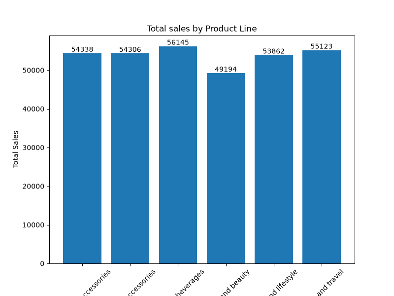
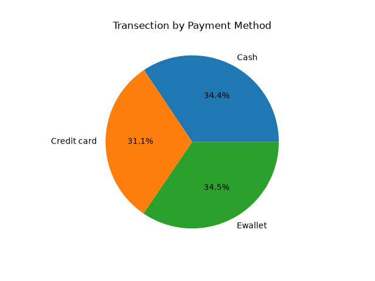
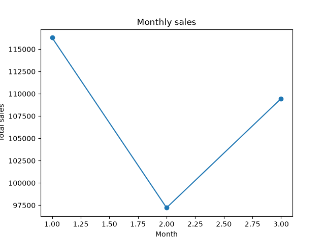
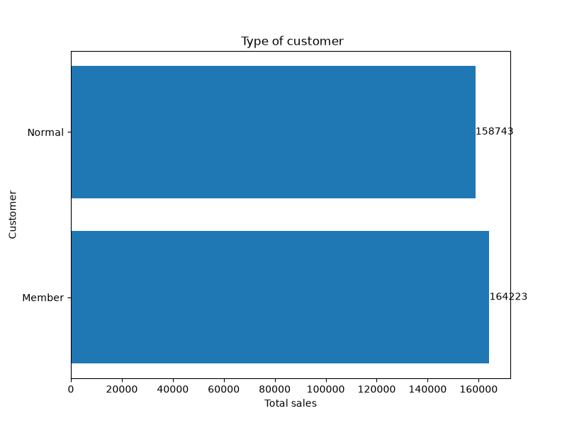
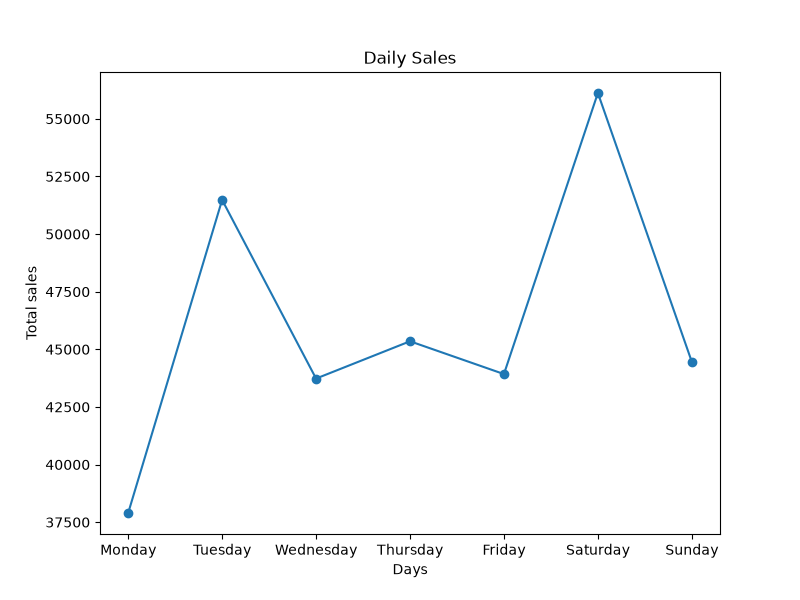

# Supermarket Sales Analysis

## Project Overview

This project analyzes supermarket sales data using Python to identify sales patterns across product lines, branches, payment methods, customer types, and days of the week.

## Tools

- Python
- NumPy
- Pandas
- Matplotlib

## Data Cleaning
- Checked missing values
- Checked and handled duplicate records
- Converted the Date column into datetime format

## Exploratory Data Analysis
- Branch C recorded the highest total sales among all three branches.
- Food and Beverages generated the highest total sales among all product lines.
- Cash was the payment method with the highest total sales.
- E-wallet had the highest number of transactions.
- Member customer generated higher total sales than normal customer.
- January recorded the highest monthly sales.
- Saturday recorded the highest daily sales.

## Data Visualization

### 1. Product Line Sales


### 2. Branch Sales


### 3. Payment Method Distribution


### 4. Monthly Sales Trend


### 5. Customer Type Analysis


### 6. Daily Sales Trend



## How to Run the Project
## Installation

Install the required libraries using pip:

```bash
pip install pandas numpy matplotlib
```
## How to Run the Project

1. Clone or download this repository.
2. Make sure Python is installed.
3. Install the required libraries.
4. Run the Python script:

```bash
python supermarket_sales.py
```